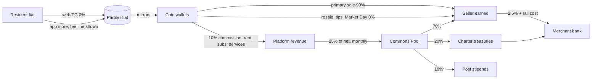

# 09. Economy and business model

Design document v1, 2026-10-09. Owner: Ledger, payments and compliance. Inputs: spine C.4, C.10, D.2, D.3, D.8. **Derived** marks this document's own arithmetic; canonical figures are unchanged. L is October 2028; money is US$.

## Summary

nolife earns money from five sources, in order of weight: rent on Holdings, Resident subscriptions, a 10% primary commission, a 2.5% cash-out fee, and services. It never charges for visitors, growth or success, and it spends US$0 on paid acquisition. Money enters as Coin, a display of stored value held by a licensed partner. 100 Coin = US$1.00, with no spread, and buying Coin on web or PC costs nothing. A creator who sells an item and cashes out pays 12.5% all-in, and that figure is printed on one Fee Page next to a 5% required margin. Every month, a quarter of net revenue goes back as the Commons Pool: 70% to creators, 20% to Charters and venues, 10% to public Posts. The model breaks even at 350K MAU with 60 staff and earns +US$2.3M at 600K. At 100K MAU, a 25-person Floor Plan loses US$0.9M a year against a US$6M reserve. US$45M funds launch and break-even at L+36.

## Money flows end to end

### Ledger accounts

The Ledger is a double-entry journal. The licensed partner holds the fiat behind every balance in a safeguarded account.

| Account | Holder | Holds | Rules |
|---|---|---|---|
| Wallet `allowance` | Resident | 300 Coin a month | Spend-only. It becomes `earned` once it reaches a seller. |
| Wallet `purchased` | Passport | Coin bought with fiat | Refund-to-source only (see Payments) |
| Wallet `earned` | Passport | Sales, tips, Pool, stipends | Cash-out only for Merchants. Card-funded value waits in a 14-day clearing hold. |
| Charter treasury | Charter (M-of-N signers) | Dues, Pool share, sales | Can be attached to a legal entity |
| Platform revenue | Operator | Commission, fees, rent and subscriptions paid in Coin | Retired against fiat |
| Pool accrual | Operator, ring-fenced | 25% of net, accrued daily | Paid out monthly; no other use |
| Ticket escrow | Operator | Commons tickets (US$24) | Losers refunded within 24 h |
| Re-delivery Fund | Operator | US$1.5M, L-6 to L+24 | 10 Coin per claim, at most US$5,000 per merchant |
| Keepalive escrow | Per product | Life-support deposits | See doc 04 |
| Founders' Pass trust | Segregated bank account (fiat) | Prepaid passes | Released at 1/36 a month; not runway |

A wallet spends `allowance` first, then `purchased`, then `earned`. This order protects the value a creator can cash out.

**Invariants**, reconciled with the partner every day. Any break in reconciliation halts cash-out.
1. The sum of all Coin balances equals the fiat in the partner's safeguarded account, with zero tolerance.
2. Every Coin has a fiat source: either a resident bought it, or the operator funded it (allowance, Pool, stipends, Re-delivery). The operator pays the fiat in *before* crediting any wallet.
3. Keepers have no wallet. A Keeper's Passport type cannot be the counterparty of any posting.
4. For every seller, gross consideration, fees withheld and payout account are first-class journal fields. These are the DAC7 fields.



### Example: one US$10 sale

1. A buyer in Lisbon sees the euro price first, then 1,000 Coin; holding 400 Coin, they top up exactly 600 by Pix at 0%.
2. The Ledger draws 300 from `allowance`, 600 from `purchased` and 100 from `earned`.
3. The item carries a 5% Component Royalty and a 70/30 Split: 100 Coin commission, 50 Coin royalty (both on gross), and 850 Coin split 595 / 255.
4. After the 14-day clearing hold, weekly cash-out charges 2.5% plus rail cost.
5. For 90 days the buyer adds Pool weight to the seller and the royalty holder in every month they visit on 2 or more days.

## Revenue lines and price list

Shares below are taken from the D.8 Reference column (600K MAU).

| Line | US$M/yr | Share | Driver |
|---|---|---|---|
| Holding rent | 20.9 | 49% | 5% of MAU × US$58/month |
| Resident subscriptions | 7.6 | 18% | 12% of MAU × US$105 net/year |
| Commission | 10.8 | 25% | US$200 primary sales per MAU-year at an effective 9% |
| Cash-out fees | 1.1 | 3% | 2.5% of US$75 per MAU-year |
| Other services | 2.4 | 6% | Campus, Estate ticket share, Event Mode, Darkroom, staffed brand events |

Rent plus subscriptions make up 66% of revenue, against the R6 test of at least 50% by L+24. Brand events are sold on measured attendance, never as land. There is no advertising, no sponsored discovery and no sale of streamed hours.

### Price list (canonical, D.3)

| Product | Price | Includes |
|---|---|---|
| Free account | US$0 | Hearth (1 room, 8 guests, 1,000 Weight); 2,000 items / 1 GB; Maker selling |
| Resident | US$9.99/month or US$99/year | Hearth+ (4 rooms, 25 guests, 4,000 Weight); 20 GB; 300 Coin monthly allowance shown in fiat |
| Extra storage | US$1 per 10 GB-month | |
| Plot S | US$19/month | ¼ cell, 4,000 Weight, 4 GB |
| Plot M | US$35/month | ½ cell, 10,000 Weight, 10 GB |
| Cell | US$69/month | 256 m, 30,000 Weight, 30 GB. Printed cost basis US$14: compute US$10 (~70 awake hours on 2 vCPU), storage and escrow US$2, operations US$2 |
| Domain | US$249/month | 4 contiguous cells, 120,000 Weight |
| Non-profit and education | 50% off | Class Cell US$34.50 |
| Commons plot | US$8/month | 2,048 m², 900 Weight. Lottery ticket US$24 (3 months prepaid), refunded in full to losers within 24 h |
| Homestead Kit | US$29 per cell-month | Partners only, from L+12 |
| Event Mode above 1,000 presence | US$0.004 per reserved avatar-hour | Waived for Civic Calendar events |
| Darkroom | 10 free renders/month, then 10 Coin each | |
| Stream | 2 free hours per new account on a Compat device | Cost published at US$1.75/h; capped at 5% of infrastructure |

**Rent rules.**
- Rent is priced on Weight and bytes, never on traffic.
- The only metered activity is an Event Mode reservation. For example, a 3,000-person, two-hour concert that is not on the Civic Calendar pays (3,000 − 1,000) × 2 × US$0.004 = US$16.
- Every sub-let listing prints the base rent next to the landlord's fee.
- Any price rise needs 12 months' notice and grandfathering. Under grandfathering, a Holding keeps its price for as long as the same Passport or Charter holds it continuously. A transfer resets it to list.

**Billing state machine.** Nothing is deleted for non-payment.

```
Active --payment fails--> Grace (7 days, fully functional, 3 retries) --paid--> Active
Grace  --unpaid--> Frozen (90 days, read-only, no arrears accrue) --month paid--> Active
Frozen --day 90--> Archived (NAR in owner inventory, restorable indefinitely)
```

When a landlord's Holding enters Grace, its sub-tenants are told the same day. Each sub-tenant may take over the base lease of their own parcel at list price.

**Rejected.** Metered compute above a visitor allowance (economist) charges places for popularity. Paid Hearths, US$199 Halls, a US$899 lifetime tier and a "Citizen" subscription (sociologist) rest on a non-credible payer share, an unbounded liability and sold civic standing. Near-free idle persistence (business-models brief) covers nothing at Linden scale per the taxonomy's reconciliation. Resident Plus at US$19.99 (economist) adds a status gradient, not bytes.

## The Fee Page and required margin

The Fee Page is one versioned, signed page, published as HTML and JSON at a stable URL. Every change is logged in the Chronicle. The draft is due in March 2027.

| Line | Rate |
|---|---|
| Buy Coin on web or PC | 0%. The platform absorbs about 3% processing. |
| App-store top-ups | The store fee is shown as a separate line. Store-routed money-in must be at most 25% by L+12. |
| Primary commission | 10% on the Bazaar, in-world vendors and the API. Founding Merchants pay 5% for 12 months from L. Body and head vendors' Re-delivery editions pay 0% for 12 months. |
| Resale, tips, in-person Market Day sales, off-platform-paid deliveries | 0%. An optional resale royalty of up to 10% can go to the creator. |
| Estate tickets and priority | 10% |
| Cash-out | 2.5% plus the pass-through rail cost (US$0.25 ACH, EUR 0.50 SEPA, ~US$2 international). Minimum 2,500 Coin domestic, 10,000 Coin international. Paid weekly. |
| **Required margin** | 5% of gross |
| **Worked example** | A US$10 sale leaves 900 Coin. Cashed out within a US$100 payout, the all-in take is 12.5%. |

An "in-person Market Day" sale must happen on a Saturday (Ward local time), at a Market stall, with the seller or a Split member present as a human in the same cell. A Stand-in does not qualify, because Keepers hold no money.

### Worked example at different payout sizes (derived)

| Case | After commission | Cash-out fee | Rail cost share | Creator nets | All-in take |
|---|---|---|---|---|---|
| Domestic ACH, US$100 payout | US$9.00 | 0.225 | 0.0225 | US$8.75 | **12.5%** (canonical) |
| Domestic ACH, US$25 minimum payout | US$9.00 | 0.225 | 0.09 | US$8.69 | 13.2% |
| International, US$100 minimum payout | US$9.00 | 0.225 | 0.18 | US$8.60 | 14.1% |
| Founding Merchant, US$100 ACH | US$9.50 | 0.2375 | 0.024 | US$9.24 | 7.6% |

Every case stays inside R7's 15% ceiling. For comparison:
- Second Life residents estimate their all-in take at 20-31%, against the marketed "90/10" ([source](https://community.secondlife.com/forums/topic/519135-linden-claims-to-only-take-10-off-creators-but-they-really-take-20-by-the-time-you-pay-marketplace-fees-cash-out-fake-advertising-by-phil/)), after Linden doubled its Marketplace commission to 10% in 2019 ([source](https://ryanschultz.com/2019/11/25/editorial-second-life-users-are-less-than-happy-about-linden-lab-doubling-commission-rates-on-the-sl-marketplace-from-5-to-10/)).
- VRChat creators earn about 50% of store spend ([source](https://creators.vrchat.com/economy/payout)).
- Roblox creators earn about 25% ([source](https://gamesbeat.com/fortnite/)).

### Required margin and the margin governor

The 5% required margin is the steady-state operating result needed to keep the Floor Reserve topped up and to absorb shocks. D.8 reaches it at Reference scale (2.3 / 42.8 = 5.4%) but only 2.0% at break-even. The Fee Page prints the actual figure next to the target each year.

This document adds a **margin governor**:
- **Trigger:** trailing 12-month operating margin above 10% of gross while the Floor Reserve is full.
- **Obligation:** within 90 days, the operator publishes a fee cut, a Pool increase or a written justification.
- **Review:** the Assembly may demand a public review of whichever is published.

An external auditor recomputes the effective take by seller cohort from the journal every year. It must be within 2 points of the published figure (R7).

**Rejected.**
- *1.5% cash-out plus a 4% spread, and a 3% top-up fee* (engine, open-web). A spread is invisible at the point of sale, which is how SL's "90/10" became 20-31%.
- *A floating, LindeX-style rate.* It makes "real-money price at purchase" untrue for part of each day.

## Commons Pool economics

### Formula

```
Pool_m       = 0.25 × (Gross_m − Processing_m − Refunds_m − Taxes_m)
Lines        = Creators 0.70 | Charters & venues 0.20 | Public Posts 0.10

RPU(u, m)    = ≥1 qualifying purchase (≥100 Coin, not self or own Split) in the 90 days to m-end
               AND visits on ≥2 distinct days in m AND human Passport (no Keepers, no flagged bots)
w(u)         = (1.0 verified | 0.5 unverified) × 1.75 for 6 months if referred as new or lapsed

CreatorWeight(c) = Σ w(u) over distinct RPUs who bought c's goods in the window, wherever sold
                   (Component Royalty and Split recipients included)
                 + w(recipient) for each equipped Starter Catalogue item of c, for 90 days
VenueWeight(v)   = Σ w(u) over distinct RPUs attending ≥2 of v's scheduled events on distinct
                   days in m; a person counts toward at most 3 Charters or venues a month
PostShare(p)     = public shift-hours worked by p / all public shift-hours in m

Payout(c) = 0.70 × Pool_m × CreatorWeight(c) / Σ CreatorWeight
```

- Payouts land in `earned` on the 10th of each month. The first payout is at L+1 (November 2028).
- Census publishes the formula, the full distribution and the median every quarter.

### Anti-farming

Purchasers only; unverified accounts weigh 0.5; one Pool identity per person, bound to Passport and payout account. Purchases under 100 Coin, or between accounts sharing a payout account, Split or device cluster, are excluded. A place or creator whose RPU mix trips the bot detector is held pending review; bot and Keeper shares are published. Off-platform deliveries count only with a signed receipt from a Bazaar-certified store and a buyer who is already an RPU on-platform.

### Illustrative month at Reference scale (derived)

The Pool is US$833K a month. Assume 120K RPUs, each buying from 4 creators on average.

| Line | Pot | Assumed weight | Per unit | Example | Payout |
|---|---|---|---|---|---|
| Creators | US$583K | 520K | ~US$1.12 | Creator with 500 verified returning buyers | ~US$560 |
| Charters and venues | US$167K | 80K | ~US$2.08 | Venue with 200 returning attendees | ~US$416 |
| Public Posts | US$83K | ~1,200 Posts | ~US$69 | One Ward Warden Post | ~US$69 |

The published median is the honest number, and it will be small. Pools follow a power law: Roblox's top 1,000 creators averaged US$1.3M in Q4 2025 ([source](https://quartr.com/events/roblox-rblx-q4-2025_ozGB34Pf)).

### Public Post stipends

The 10% line pays only Landing Hosts, Ward Wardens and Jurors (each Ward has 8 Warden and 12 Host Posts). Stipends are honoraria, since Standing is the main reward, capped at 1,500 Coin per shift-hour with excess rolling forward. Alpha Hosts before L+1 are paid from the Founding Programme budget.

### Why 25% of net

Epic pays 40% of net revenue into its engagement pool ([source](https://www.fortnite.com/news/unreal-editor-for-fortnite-and-creator-economy-2-0-are-here-new-worlds-await)); its November 2025 rewrite counts only purchasers and pays a 75% six-month bonus for new or lapsed players ([source](https://www.fortnite.com/news/fortnite-developers-will-soon-be-able-to-sell-in-game-items)). nolife copies both rules but not the rate: at 40% the Reference result falls from +US$2.3M to about −US$3.7M (derived). The 20% venue line exists because engagement pools pay maps, not the people who make a place worth returning to.

## Unit economics at three scales

**Canonical assumptions.**
- DAU is 25% of MAU, and average CCU is 4% of MAU.
- Paid Holdings are 5% of MAU (8% at the Floor) at US$58/month.
- Residents are 12% of MAU at US$105 net per year.
- Primary sales are US$200 per MAU-year at an effective 9% commission.
- Cash-out is US$75, Coin purchases US$100 and other revenue US$4, all per MAU-year.
- Infrastructure costs US$0.025 per CCU-hour.
- T&S costs US$1.50 per DAU-month, with a US$1.5M floor.
- The engine licence costs 3% of gross, and staff US$150K loaded.

The Floor assumes 8% Holdings because a world at that size is mostly Founding Charters, whose members rent more than casual visitors do.

### The canonical model (D.8, reproduced exactly)

| US$M/yr | Floor: 100K MAU, 25 staff | Break-even: 350K, 60 staff | Reference: 600K, 100 staff |
|---|---|---|---|
| Holding rent | 5.6 | 12.2 | 20.9 |
| Resident subscriptions | 1.3 | 4.4 | 7.6 |
| Commission | 1.8 | 6.3 | 10.8 |
| Cash-out fees | 0.2 | 0.7 | 1.1 |
| Other services | 0.4 | 1.4 | 2.4 |
| **Gross revenue** | **9.2** | **24.9** | **42.8** |
| Processing (3% of money-in) | 0.5 | 1.5 | 2.7 |
| Commons Pool | 2.2 | 5.9 | 10.0 |
| Infrastructure | 0.9 | 3.1 | 5.3 |
| Trust and safety | 1.5 | 1.6 | 2.7 |
| Engine licence | 0.3 | 0.7 | 1.3 |
| Staff | 3.8 | 9.0 | 15.0 |
| Compliance, legal, localisation, payout ops | 0.8 | 2.2 | 3.0 |
| Acquisition (Re-delivery, Founding programmes, Ephemeral Ward) | 0.2 | 0.5 | 0.5 |
| **Operating result** | **-0.9** (Reserve lasts ~7 years) | **+0.5** | **+2.3** |

### How the lines are computed (derived check)

Each line follows from the assumptions. At Reference: rent 30,000 × 696 = 20.88; subscriptions 72,000 × 105 = 7.56; processing 3% × (Coin purchases + rent + subscriptions) = 2.65; Pool 25% × (gross − processing) = 10.0; infrastructure 24,000 CCU × 8,760 h × 0.025 = 5.26; T&S max(1.5, DAU × 18) = 2.7. At the Floor, T&S sits at its US$1.5M minimum (25K DAU × US$18 is only US$0.45M), which makes it 16% of gross, the largest cost after staff.

### Per-unit economics (derived)

- **Cell, per month.** Rent of US$69 less processing (2.07), Pool share (16.73), engine licence (2.07) and cost basis (14) leaves **about US$34** for staff, T&S and margin. That cost basis assumes about 70 awake hours. A Cell awake around the clock would need about US$100 of compute, which is why hibernation is a stated rule.
- **Resident, per year.** US$105 less processing (3.15), Pool share (25.46) and engine licence (3.15) leaves **about US$73**. If the US$36 allowance is booked as a cost, it leaves about US$37 (see Open questions).

## Sensitivity and Coin conservation

### Canonical sensitivity (D.8)

- **Halve primary sales and subscriptions at Reference scale:** the result is about **−US$4.2M** (derived: revenue falls 9.18; processing, Pool and licence offsets add back 2.66).
- **Hold headcount at 75 in that case:** the result is about **−US$0.4M** (25 × US$150K = 3.75).

Headcount is therefore a control, not a target. Hiring follows booked recurring revenue, never forecast revenue.

### Further sensitivities (derived, Reference, one change at a time)

| Change | Result (US$M) |
|---|---|
| Paid Holdings at 4% of MAU | −0.6 |
| Average Holding price US$45 | −1.0 |
| Infrastructure +50% | −0.3 |
| T&S at US$3/DAU-month | −0.4 |
| Pool at 40% of net (rejected) | −3.7 |
| Store-routed money-in at 50% | 0 as designed (buyer pays the store line); about −10 if absorbed |

The response to any negative row is to hold hiring; prices are never raised retroactively. The last row is the Rec Room lesson. Rec Room kept 30 cents of each UGC dollar after store fees and shut down despite having runway ([source](https://blog.recroom.com/posts/2025/8/28/rec-room-finances-and-ugc-revenue); [source](https://www.geekwire.com/2026/rec-room-shutting-down-seattles-3-5b-social-gaming-platform-says-it-cant-make-the-business-work/)).

### Coin conservation check (canonical, Reference, US$M/yr)

| Coin in | | Coin out | |
|---|---|---|---|
| Purchases | 60.0 | Commission | 10.8 |
| Allowances | 2.6 | Cash-out | 45.0 |
| Pool | 10.0 | Fees | 1.1 |
| | | Rent and subscriptions paid from balances | 13.5 |
| | | Services | 2.2 |
| **Total** | **72.6** | **Total** | **72.6** |

Reading it: inflows equal outflows, so the float is stable; the US$120M of primary sales circulates inside the float, so purchased Coin turns over about twice; allowances (72,000 × US$36 = 2.59) and the Pool are operator issuance funded in fiat first (invariant 2); and revenue received in Coin (10.8 + 1.1 + 13.5 + 2.2 = 27.6) plus revenue received in fiat (about 15.1) reconciles to the gross of 42.8.

Census publishes this table quarterly from the journal, together with the float, velocity and cash-out ratio (cash-out ÷ Coin in). A cash-out ratio above 70% is the warning that the world is becoming a payout pipe.

## Funding, the Floor Plan and the Tripwire

**Envelope (canonical): US$45M.**
- Seed: US$12M, November 2026.
- Series A: US$33M, June 2028, including the US$6M Floor Reserve.

This funds 24 months to launch and 36 months to break-even. The plan excludes any token, land sale, sibling product or headset-maker investor.

**Series A gates** (all four required, measured in the alpha):
1. At least 15 Founding Charters, each with at least 50% of invited members active monthly.
2. Alpha Landing D30 at least 3 points above the holdout.
3. At least 1,000 paid Holdings billing.
4. A published plan with a headcount cap of 60.

### Cash plan (derived)

| Period | Use | US$M |
|---|---|---|
| Seed, Nov 2026 to Jun 2028 | 690 staff-months (20 → 40 by Dec 2027 → ~48) | 8.6 |
| | Engine, rail, age-assurance and escrow onboarding; legal | 1.4 |
| | Alpha T&S vendors and infrastructure | 0.95 |
| | Contingency | 1.05 |
| Series A, Jul 2028 to Oct 2031 | Floor Reserve (ring-fenced) | 6.0 |
| | Pre-launch quarter (~55 staff) | 3.0 |
| | Re-delivery Fund (booked separately, conservatively) | 1.5 |
| | Operating loss, L to L+12 (average ~50K MAU) | 10.5 |
| | Operating loss, L+12 to L+24 (average ~150K MAU) | 6.9 |
| | Operating loss, L+24 to L+36 (average ~275K MAU) | 2.2 |
| | Contingency | 2.9 |

The loss lines apply the D.8 method to the D.7 ramp (100K / 200K / 350K MAU at L+12 / L+24 / L+36), with 60 staff, the T&S floor, and Founding Charter rent waived until L+6. The plan reaches L+36 without touching either the Floor Reserve or the Founders' Pass trust.

### The Floor Plan

The Floor Plan is the survival configuration: 25 staff at 100K MAU, with the Reserve covering the −US$0.9M a year for about 7 years.
- **Kept:** the Ledger, rail and compliance, Reader, Ember, Compat, mobile Lite, Charter Import, the Landing, the Safety Kit, escrow and Census.
- **Cut, in this order:** Hypergate, the VR view, the Keeper experiment, the Homestead Kit, Event Mode validation beyond 2,000, and Reference polish (Lantern drops to Lite parity).
- **Deferred:** the Japanese and German Wards.

### The Tripwire

```
Normal --(L+9 indicators amber)--> Watch (published) --(condition met)--> Triggered
Triggered --(board resolution ≤7 days; Chronicle entry; Assembly briefed)--> Floor transition (90 days) --> Floor steady
```

The Tripwire fires if either condition is met:
- the Series A has not closed by 30 September 2028; or
- at L+12, fewer than 10 named SL institutions are active with at least 50% of their imported membership, or MAU is below 60K.

A Floor transition changes no price and no covenant, and it does not start a shutdown. Only the sunset covenant (12 months' notice plus escrow release) can do that.

The engine exit (US$16M over 21 months, a planning value) sits outside the envelope. If Unreal fails, Ember carries the world on Lite and Compat, and Reference waits.

**Rejected.** A US$75-95M raise with a 120-person cap (engine) recreates subsidy collapse; US$33M with 45 staff (studio) and US$40M with launch at month 12-15 (economist) are not buildable; 25,000 passes at US$399 with rent credit (economist) is too large a liability.

## Team plan and spend sequencing

| Function | Seed | Dec 2027 | L (canonical) | Floor | Reference |
|---|---|---|---|---|---|
| Lantern | 3 | 8 | 12 | 3 | 16 |
| Grid | 6 | 9 | 10 | 5 | 14 |
| T&S, policy, community, localisation (4 PT/ES CMs at L) | 1 | 5 | 10 | 5 | 22 |
| Foundry, Workshop, tools | 3 | 5 | 7 | 2 | 10 |
| Ember | 2 | 3 | 5 | 3 | 7 |
| Product, design, research | 1 | 3 | 5 | 1 | 10 |
| Exec, finance, legal, people | 2 | 3 | 5 | 2 | 9 |
| Ledger, payments, compliance | 2 | 3 | 4 | 3 | 8 |
| Reader and accessibility | 0 | 1 | 2 | 1 | 4 |
| **Total** | **20** | **40** | **60** | **25** | **100** |

The totals are canonical; the splits outside the L column are derived. Vendors cover first-line moderation, age assurance, the rail, voice and hosting (two providers from L).

**Hiring rules.**
- Headcount is capped at 60 until trailing three-month rent plus subscriptions covers payroll.
- After that, each further 10 heads needs US$1.5M more of annualised recurring revenue.
- The Floor keeps Ledger and Reader staffed, because losing either breaches a covenant.

**Spend gates.** Finance releases a line only after the milestone it depends on is recorded in the Chronicle.

| Gate | Released item | Requires |
|---|---|---|
| Rail and compliance before graphics | Reference polish beyond Lite parity | Rail and age-assurance contracts signed, adult policy on file (Dec 2027) |
| Reader before VR | VR view staffing (L+30) | Reader passes the XAG 119/GAG checklist; maintainer funded |
| Charter Import before the Bazaar | Bazaar launch | Charter Import demonstrated in the alpha |
| The Landing before Keepers | Keeper experiment (L+12) | L+6 holdout result meets the keep rule |
| Compat before Reference polish | Any Reference-only feature | Compat meets 33.3 ms on reference devices |
| Growth from surplus | Anything outside the D.1 timeline | Rent plus subscriptions cover operating costs |

**Paid acquisition: US$0.** Mobile CPIs of US$1-4 at 1-2% payer rates imply US$75-300 per payer ([source](https://liftoff.ai/?p=34267)). Growth comes instead from Founding Charters, the Bridge, Re-delivery, the Pool's referral bonus and the Ephemeral Ward.

## The Founding Programme

**Founding Charters.** 50 communities, 25 of them by L. Each gets a migration engineer and a first Cell (a Domain above 500 members) rent-free until L+6, then 30% off list frozen for 36 months (US$48.30 a Cell, US$174.30 a Domain), reverting to list after 12 months' notice. Each runs a weekly public event and names deputies. Cure rule: 4 missed weekly events in a row, or a deputy slot empty for 30 days, triggers a notice; after 30 days uncured the frozen rate converts to list. The Holding is never taken. Cost (derived): under US$0.1M of forgone rent.

**Founding Merchants.** The first 1,000 verified creators get 5% commission for 12 months from L, funded catalogue conversion, the creator claim (a one-time SL-profile code signs the catalogue to their Passport) and Re-delivery. Cost (derived): about US$0.2M of commission in year one if they carry a third of ~US$10M of sales.

**Re-delivery Programme and Fund.** A migrating resident who proves an SL purchase claims the nolife edition; the creator earns **10 Coin per claim**, up to **US$5,000** (50,000 claims), from the **US$1.5M Fund** running **L-6 to L+24**. Body and head vendors' editions pay 0% commission for 12 months. Unspent money returns at L+24 and is reported in Census. Kitely's re-delivery of Kitely Market purchases to stranded OSgrid users is the precedent ([source](https://www.hypergridbusiness.com/?p=79686)).

**Founders' Pass.** US$249 for 36 months of Resident (US$6.92 a month), capped at 20,000 passes (at most US$5M), held in a segregated account, refundable pro rata at any time including on a shutdown notice, and not counted as runway. Revenue is recognised at 1/36 a month. On sale from January 2028 until L+6 or the cap; non-transferable. Hytale funded development from pre-purchases ([source](https://en.wikipedia.org/wiki/Hytale)); SL reached profit in 2005 on US$25M raised ([source](https://gamesbeat.com/linden-lab-has-spent-1-3b-building-second-life-and-paid-1-1b-to-creators/)).

## Payments, tax and consumer law

### Coin and consumer law

**What Coin is.** Coin is a display unit for stored value held by the licensed partner, which is the Tilia model; Linden sold Tilia to Thunes with a five-year partnership ([source](https://modemworld.me/2024/04/23/linden-lab-to-sell-payments-platform-tilia-to-thunes/)).
- Local fiat is shown first, at a daily-fixed rate.
- Coin is sold in exact amounts, with no bundles, no odd pricing and no second currency.
- No chance mechanic pays out anything that can be cashed out. Lineage outcomes are either previewed before commit, or random only for non-transferable offspring.

**EU fit.** This matches the CPC Network's 2025 Key Principles: fiat at every price, exact amounts, one currency, pre-contractual information, and a 14-day withdrawal right ([source](https://techinsights.linklaters.com/post/102k6t4/game-changer-eu-introduces-consumer-protection-guidance-for-in-game-virtual-curr)). Stipends paid in a currency that is also sold for cash get no gameplay-only carve-out, so they always show fiat ([source](https://www.twobirds.com/en/insights/2025/global/regulatory-spotlight-virtual-currency-vs-consumer-law-part-2)).

**Refunds and transfers.** Unspent `purchased` Coin is refundable to its original payment method within 14 days, no questions asked, and redeemable to source (less rail cost, never to a new account) after that. Only `earned` Coin held by a Merchant cashes out. Below Trust "Known", peer-to-peer transfers are capped at 25,000 Coin a month.

### The DFA fallback

The Digital Fairness Act is expected in Q4 2026 and remains unpublished ([source](https://www.heuking.de/en/news-events/newsletter-articles/detail/digital-fairness-act-implementation-obligations-companies-need-to-prepare-for.html)). Its consultation backed fiat display and a virtual-currency opt-out ([source](https://thelens.slaughterandmay.com/post/102m222/digital-fairness-act-european-commission-publishes-responses-to-consultation)). BEUC is asking for paid in-game currencies to be banned ([source](https://techcrunch.com/2024/09/12/bad-credits-consumer-group-files-eu-suit-over-manipulative-payments-in-games-like-fortnite-and-minecraft-calls-for-a-ban)).

The fallback is a per-jurisdiction flag, `display.unit = coin | fiat`. If the DFA restricts paid currencies, every price and balance displays in fiat cents while the Ledger, the peg and every fee stay unchanged. The text is reviewed within 90 days of publication; both renderings ship from L, and fiat mode runs in one EU locale during the alpha.

### App stores

- **Fees and share:** the store fee is shown as a separate line. Store-routed money-in must be at most 25% by L+12.
- **Packages:** store SKUs come in 100, 500, 1,000, 2,500 and 5,000 Coin, so any shortfall can be covered within 100 Coin.
- **Age law:** Texas's App Store Accountability Act is in force pending appeal ([source](https://www.pearlcohen.com/fifth-circuit-stays-injunctions-against-texas-app-store-accountability-act/)). Native builds read age signals, and minors are admitted only to Campus, where nothing is for sale.

### Cash-out and the adult contingency

- **Rail and markets:** contract signed by December 2027; Merchants are verified adults; weekly payouts with failures under 1%; Coin and cash-out in the US, UK and EU from the alpha, Pix money-in at L, konbini at L+12.
- **Merchant category code:** purchases are coded as stored value, never under an adult MCC. Visa's VIRP puts adult content in Tier 1 under MCC 5967 ([source](https://www.legitscript.com/regulatory-and-card-brand-compliance/adult-escort-and-dating-merchants-are-your-practices-in-line-with-virp-updates/)).
- **Adult-tagged goods:** these need the Night Ward check, uploader verification, consent records and human pre-publication review, which are Mastercard's AN 5196 controls ([source](https://verifymy.io/resources/regulation/card-brand-requirements)).
- **Reserve acquirer:** an adult-specialist acquirer is pre-qualified, because Stripe prohibits adult content ([source](https://conductatlas.com/platform/stripe/stripe-restricted-businesses-list/adult-content-prohibition-and-restriction/)) and Adyen restricts it ([source](https://adyen.com/legal/list-restricted-prohibited)).
- **Deindex-but-sell:** the switch acts within hours, following itch.io's path ([source](https://www.thesixthaxis.com/2025/07/24/itch-io-delists-all-adult-nsfw-content-due-to-pressure-from-payment-processors-and-collective-shout/)).
- **Exclusion from cash-out:** this is a contingency that only a processor can trigger. Tumblr's exit cost about 29% of its traffic ([source](https://thenextweb.com/insider/2019/03/14/tumblr-traffic-dropped-by-nearly-100m-the-month-after-it-banned-porn/)), and OnlyFans reversed its ban within a week ([source](https://www.cbc.ca/lite/story/1.6148524)).
- **Measurement:** spend is tagged by maturity from day one, and the adult share is published.

### Tax

- **Collected before the first payout:** W-9 or W-8BEN/W-8BEN-E, plus the DAC7 set for EU residents (name, address, date of birth, TIN, VAT number, payout account). Services have no DAC7 floor ([source](https://www.fonoa.com/blog/dac7overview)).
- **DAC7 reporting:** journal fields yield quarterly consideration and fees withheld; due diligence by 31 December, filing by 31 January; a non-EU operator registers in one member state.
- **1099-K:** issued above US$20,000 *and* 200 transactions ([source](https://irs.gov/newsroom/irs-issues-faqs-on-form-1099-k-threshold-under-the-one-big-beautiful-bill-dollar-limit-reverts-to-20000)), the same trigger Linden uses ([source](https://wiki.secondlife.com/wiki/Linden_Lab_Official:Required_Tax_Documentation_FAQ)).
- **Platform-paid income:** Pool payouts and stipends are platform-paid income, tracked for 1099-NEC/MISC, whose threshold is US$2,000 from 2026 ([source](https://www.avalara.com/blog/en/north-america/2025/07/one-big-beautiful-bill-act-1099-reporting-threshold.html)). Backup withholding at 24% is budgeted.
- **VAT and sales tax:** VAT and sales tax on rent, subscriptions and services follow the buyer's declared country, as SL does ([source](https://secondlife.com/corporate/vat)).
- **Campus:** Campus has no Coin. Institutions are invoiced for Class Cells in fiat, which keeps ECA Digital, PP Tunas and Texas consent rules out of the Ledger.

## Requirements addressed

| R | How |
|---|---|
| R6 | Rent on Holdings, Hearth+ and storage; traffic free; Event Mode at cost; rent plus subscriptions at 66%; mix published annually |
| R7 | Fee Page; 0% to buy; 12.5% round trip with a 15% worst case; 0% resale; margin printed; store share ≤25% by L+12; annual audit |
| R8 | Pool at 25% of net split 70/20/10; returning-purchaser weighting; 0.5 unverified; 75% referral bonus; Starter Catalogue; median published |
| R9 | Stored value; fiat first; exact amounts; no chance-for-cash; `display.unit` DFA fallback; 90-day review |
| R10 | Licensed rail; W-9/W-8 and DAC7 before first payout; 1099-K; reserve acquirer; payout failure <1% |
| R11 | Landing Host stipends from the 10% line |
| R13 | Census: revenue mix, Pool distribution, conservation table, float, cash-out ratio |
| R14, R16, R17 | Stream capped (2 h, US$1.75/h, ≤5% of infrastructure); ticket escrow refunded within 24 h; 10% Estate share |
| R18 | Founding Charters and Merchants; Re-delivery Fund; creator claim |
| R19 | 12 months' notice; grandfathering; Fee Page changes in the Chronicle; margin governor |
| R20 | Founders' Pass refundable on shutdown; engine exit costed |
| R22 | Stored-value coding; AN 5196 controls; deindex-but-sell; processor-only exclusion |
| R25, R28 | Keepers hold no Coin and carry no Pool weight; Class Cell US$34.50 invoiced in fiat |
| R29 | Pix at L, konbini at L+12; local fiat first; Bazaar at 0% for outside stores |
| R30 | US$45M; cap of 60; Floor Plan of 25 and US$6M Reserve; Tripwire; growth gated; break-even at L+36 |

## Open questions

1. **The allowance has no cost line in D.8.** The conservation check counts 2.6 of allowance Coin as operator issuance, but D.8 books no cost for it; funding it would move the Reference result from +2.3 to about −0.3. The spine values stand. Options: define US$105 as net of allowance funding, book a contra-revenue line, or shrink the allowance. Decide before the March 2027 Fee Page.
2. **Processing is double-counted** on the 13.5 of rent and subscriptions paid from balances (about US$0.4M at Reference). It is conservative; no change proposed.
3. **The margin target is not met at break-even.** The margin at 350K MAU is 2.0% against the 5% required. Should the Fee Page print "target 5%, actual 2%"?
4. **Series A failure leaves no reserve.** The Floor Reserve sits inside the Series A, so a Tripwire on 30 September 2028 leaves only about US$1M of seed contingency. Options are a US$1.5M seed earmark or a pre-agreed bridge.
5. **The 1,000 paid Holdings gate is aggressive.** It requires 10-20% of alpha residents to pay while Founding Charters' Holdings are free.
6. **Landing Host pay at the Floor is thin.** Five schedules × 32 cohorts a day is about 58,000 host-hours a year. The Floor's 10% line of US$0.22M works out to about US$3.80 an hour. Should a top-up be provided until L+12?
7. **The Founders' Pass erodes break-even.** Passes sold until April 2029 are still live at L+36. Twenty thousand holders paying US$83 instead of US$105 costs about US$0.44M, close to the entire +0.5 result.
8. **Stored-value redemption rights.** Counsel must confirm that refund-to-source satisfies any right to redeem at par.
9. **Store SKUs versus exact amounts.** Do 100-Coin steps satisfy the CPC, or should EU top-ups be web-only?
10. **Off-platform deliveries.** Should they count toward Pool weight before Bazaar certification has a year of fraud data?
11. **Brazilian creators pay the international rail.** Should a Pix payout leg be added?
12. **Grandfathering versus indexation.** Grandfathering lasts the life of a tenancy. Is CPI-capped indexation compatible with the Never List?
13. **The Re-delivery Fund (US$0.6M a year) exceeds D.8's 0.5 acquisition line**, so this document books it to the Series A.
14. **Keepalive escrow has no price.** D.3 does not set one; set it together with doc 04 before the Bazaar opens.

## Sources

- https://community.secondlife.com/forums/topic/519135-linden-claims-to-only-take-10-off-creators-but-they-really-take-20-by-the-time-you-pay-marketplace-fees-cash-out-fake-advertising-by-phil/
- https://ryanschultz.com/2019/11/25/editorial-second-life-users-are-less-than-happy-about-linden-lab-doubling-commission-rates-on-the-sl-marketplace-from-5-to-10/
- https://gamesbeat.com/linden-lab-has-spent-1-3b-building-second-life-and-paid-1-1b-to-creators/
- https://modemworld.me/2024/04/23/linden-lab-to-sell-payments-platform-tilia-to-thunes/
- https://wiki.secondlife.com/wiki/Linden_Lab_Official:Required_Tax_Documentation_FAQ
- https://secondlife.com/corporate/vat
- https://creators.vrchat.com/economy/payout
- https://gamesbeat.com/fortnite/
- https://quartr.com/events/roblox-rblx-q4-2025_ozGB34Pf
- https://www.fortnite.com/news/unreal-editor-for-fortnite-and-creator-economy-2-0-are-here-new-worlds-await
- https://www.fortnite.com/news/fortnite-developers-will-soon-be-able-to-sell-in-game-items
- https://blog.recroom.com/posts/2025/8/28/rec-room-finances-and-ugc-revenue
- https://www.geekwire.com/2026/rec-room-shutting-down-seattles-3-5b-social-gaming-platform-says-it-cant-make-the-business-work/
- https://www.hypergridbusiness.com/?p=79686
- https://en.wikipedia.org/wiki/Hytale
- https://liftoff.ai/?p=34267
- https://techinsights.linklaters.com/post/102k6t4/game-changer-eu-introduces-consumer-protection-guidance-for-in-game-virtual-curr
- https://www.twobirds.com/en/insights/2025/global/regulatory-spotlight-virtual-currency-vs-consumer-law-part-2
- https://www.heuking.de/en/news-events/newsletter-articles/detail/digital-fairness-act-implementation-obligations-companies-need-to-prepare-for.html
- https://thelens.slaughterandmay.com/post/102m222/digital-fairness-act-european-commission-publishes-responses-to-consultation
- https://techcrunch.com/2024/09/12/bad-credits-consumer-group-files-eu-suit-over-manipulative-payments-in-games-like-fortnite-and-minecraft-calls-for-a-ban
- https://www.pearlcohen.com/fifth-circuit-stays-injunctions-against-texas-app-store-accountability-act/
- https://www.fonoa.com/blog/dac7overview
- https://irs.gov/newsroom/irs-issues-faqs-on-form-1099-k-threshold-under-the-one-big-beautiful-bill-dollar-limit-reverts-to-20000
- https://www.avalara.com/blog/en/north-america/2025/07/one-big-beautiful-bill-act-1099-reporting-threshold.html
- https://www.legitscript.com/regulatory-and-card-brand-compliance/adult-escort-and-dating-merchants-are-your-practices-in-line-with-virp-updates/
- https://verifymy.io/resources/regulation/card-brand-requirements
- https://conductatlas.com/platform/stripe/stripe-restricted-businesses-list/adult-content-prohibition-and-restriction/
- https://adyen.com/legal/list-restricted-prohibited
- https://www.thesixthaxis.com/2025/07/24/itch-io-delists-all-adult-nsfw-content-due-to-pressure-from-payment-processors-and-collective-shout/
- https://thenextweb.com/insider/2019/03/14/tumblr-traffic-dropped-by-nearly-100m-the-month-after-it-banned-porn/
- https://www.cbc.ca/lite/story/1.6148524
